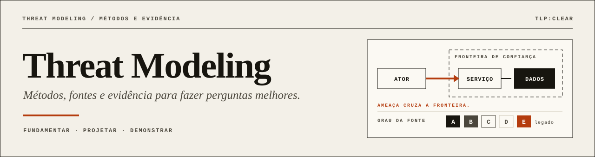

<p align="center">
  
</p>

**An awesome-style threat modeling library, with the evidence attached.** Books, papers, methods, tools and talks chosen for what they help you produce: a model, a hypothesis, a detection. Every resource carries a **source grade**, access, level and a known **limit**. What was read is kept apart from what was only listed.

<!-- lang-bar -->
[Português](README.md) · **English**
<!-- /lang-bar -->

**[Full collection](docs/AWESOME.md)** · [By topic](docs/TEMAS.md) · [Methods](docs/METODOS.md) · [Methodology](docs/METODOLOGIA.md) · [Cases](cases/README.md) · [Contributing](CONTRIBUTING.md)

> The guides and record text are written in Portuguese; titles, authors and sources are original. Source grades, topics and filters work the same in both languages, and `python scripts/query.py` is language-neutral.
>
> **Collection state:** curation and documentation. The six cases are lab proposals that have not been run. Listing a tool is not evaluating it.

## In one minute

<!-- gen:stats:start -->

| Resources | Methods | Types | Topics | Links checked |
|:---:|:---:|:---:|:---:|:---:|
| **117** | **19** | **10** | **11** | **79** |

| Grade | Resources | Meaning |
|:---:|:---:|---|
| **A** | 36 | Primary or institutional: standard, public body, peer-reviewed or the method's maintainer. |
| **B** | 59 | Primary without formal review: book, preprint, community guide, author page or maintainer repository. |
| **C** | 13 | Vendor or commercial proponent material, or a third-party tool. |
| **D** | 1 | Commentary or secondary source. |
| **E** | 8 | Legacy: inherited from the earlier collection and not yet revalidated. |

<!-- gen:stats:end -->

A grade measures the **kind of source**, not the quality of its ideas: a community guide (B) can be more useful than a paper (A).

## Start with

<!-- gen:featured:start -->

| Start with | Type | Grade | Why |
|---|---|:---:|---|
| [Threat Modeling Manifesto](https://www.threatmodelingmanifesto.org/) | Manifestos and principles | **B** | Valores, princípios e antipadrões. |
| [A Tradecraft Primer: Structured Analytic Techniques for Improving Intelligence Analysis](https://www.cia.gov/resources/csi/static/Tradecraft-Primer-apr09.pdf) | Guides and frameworks | **A** | Técnicas estruturadas de análise para desafiar julgamentos, expor modelos mentais e lidar com incerteza; inclui verificação de premissas e análise de hipóteses concorrentes. |
| [DeTT&CT — Data quality](https://github.com/rabobank-cdc/DeTTECT/wiki/data-quality-scoring) | Guides and frameworks | **B** | Completude, atraso, consistência e retenção. |
| [OWASP Threat Modeling Cheat Sheet](https://cheatsheetseries.owasp.org/cheatsheets/Threat_Modeling_Cheat_Sheet.html) | Guides and frameworks | **B** | Entender o processo e suas perguntas fundamentais; fonte consultada nesta edição |
| [Sensor Mappings to ATT&CK](https://center-for-threat-informed-defense.github.io/sensor-mappings-to-attack/) | Guides and frameworks | **A** | Sensores, eventos e visibilidade. |
| [Attack Flow](https://center-for-threat-informed-defense.github.io/attack-flow/) | Methods and models | **A** | Sequência de comportamentos. |
| [MITRE ATLAS](https://atlas.mitre.org/) | Methods and models | **A** | Base de conhecimento de táticas e técnicas adversárias contra sistemas de IA, no estilo ATT&CK. |
| [MITRE ATT&CK](https://attack.mitre.org/) | Methods and models | **A** | Vocabulário de comportamentos adversários observados; base para mapear hipóteses e cobertura. |
| [Summiting the Pyramid](https://center-for-threat-informed-defense.github.io/summiting-the-pyramid/) | Methods and models | **A** | Robustez, decomposição e cobertura. |
| [Threat Modeling with ATT&CK](https://center-for-threat-informed-defense.github.io/threat-modeling-with-attack/) | Methods and models | **A** | Comportamento adversário na modelagem. |
| [Intelligence-Driven Incident Response](https://www.oreilly.com/library/view/intelligence-driven-incident-response/9781098120672/) | Books | **B** | Inteligência e operação. |
| [Psychology of Intelligence Analysis](https://www.cia.gov/resources/csi/books-monographs/psychology-of-intelligence-analysis-2/) | Books | **A** | Vieses, hipóteses e incerteza. |
| [Threat Modeling: Designing for Security](https://threatmodelingbook.com/books) | Books | **B** | Fundamentos e abordagens. |
| [A review of threat modelling approaches for APT-style attacks](https://doi.org/10.1016/j.heliyon.2021.e05969) | Papers | **A** | Revisão de abordagens de modelagem de ameaças para ataques do tipo APT (Heliyon). |
| [HOLMES: Real-Time APT Detection through Correlation of Suspicious Information Flows](https://www.seclab.cs.sunysb.edu/seclab/pubs/holmes19.pdf) | Papers | **A** | Fluxos e correlação contextual. |
| [The Diamond Model of Intrusion Analysis](https://www.activeresponse.org/wp-content/uploads/2013/07/diamond.pdf) | Papers | **B** | Adversário, capacidade, infraestrutura e vítima. |
| [Threat modeling — A systematic literature review](https://doi.org/10.1016/j.cose.2019.03.010) | Papers | **A** | Mapear métodos e trabalhos relacionados. |
| [Keynote \| Threat Modeling Agentic AI Systems: Proactive Strategies for Security and Resilience](https://www.youtube.com/watch?v=R49Cv7pJ2KA) | Talks and conferences | **B** | Keynote gravada sobre modelagem de ameaças para sistemas de IA agêntica. |
| [ThreatModCon](https://www.threatmodcon.com/) | Talks and conferences | **B** | Conferência dedicada exclusivamente a threat modeling; fonte de talks para extrair ideias e exercícios. |
| [Threat Hunter Playbook](https://github.com/OTRF/ThreatHunter-Playbook) | Tools and repositories | **B** | Notebooks de hipótese, consultas e evidências. |

<!-- gen:featured:end -->

## By topic

<!-- gen:topics:start -->

| Topic | Resources |
|---|:---:|
| [Threat modeling](docs/TEMAS.md#modelagem-de-ameaças) | 64 |
| [Detection engineering](docs/TEMAS.md#engenharia-de-detecção) | 31 |
| [Cyber threat intelligence](docs/TEMAS.md#inteligência-de-ameaças-cti) | 35 |
| [APT and persistent campaigns](docs/TEMAS.md#apt-e-campanhas-persistentes) | 5 |
| [AI and agentic systems](docs/TEMAS.md#ia-e-sistemas-agênticos) | 7 |
| [ICS and cyber-physical systems](docs/TEMAS.md#ics-e-sistemas-ciberfísicos) | 3 |
| [Privacy](docs/TEMAS.md#privacidade) | 3 |
| [Psychology, bias and analysis](docs/TEMAS.md#psicologia-vieses-e-análise) | 2 |
| [Adversary emulation](docs/TEMAS.md#emulação-adversária) | 8 |
| [Provenance and graphs](docs/TEMAS.md#proveniência-e-grafos) | 4 |
| [Cloud](docs/TEMAS.md#nuvem) | 3 |

<!-- gen:topics:end -->

## Quick start

```bash
make check                                       # validate data, run tests, verify generated files
python scripts/query.py search "apt provenance"  # whole-word search
python scripts/query.py list --topic psychology --max-grade B
python scripts/query.py list --type tool --access free --level intro --lang en
python scripts/query.py show holmes              # full record
python scripts/query.py method stride            # a method with its sources and limit
python scripts/query.py export --format csv > collection.csv
python scripts/check_links.py                    # link report (needs network)
```

Python 3.10+, standard library only. `make build` regenerates the lists and the generated blocks of both READMEs from `data/`. Edit the data, never the generated files.

## Editorial rules

- Original source, authorship, publication type, contribution and limitation for every entry.
- Fact, inference and hypothesis are kept apart.
- A preprint, a published paper and a talk do not carry the same weight.
- Visibility is not detection; a mapping does not prove effectiveness.
- Links to complete works at their sources; no copies of third-party books or PDFs.
- A link is stamped with a check date only when it answered; bot blocking and network failures do not count.

## Portfolio

This library organizes references and exercises. The authorial **[TCEM](https://github.com/Ridd1kulusC0d3r/Cyber-Threat-Context-Modeling)** method lives in its own repository. **[LLMInjection](https://github.com/Ridd1kulusC0d3r/LLmInjection)** covers the LLM and agentic threat landscape with the same A–E grading.

## Contributing

Suggest a resource through the [issue form](https://github.com/Ridd1kulusC0d3r/Threat-Modeling/issues/new/choose) or open a PR editing `data/resources.json`. See [CONTRIBUTING.md](CONTRIBUTING.md).
