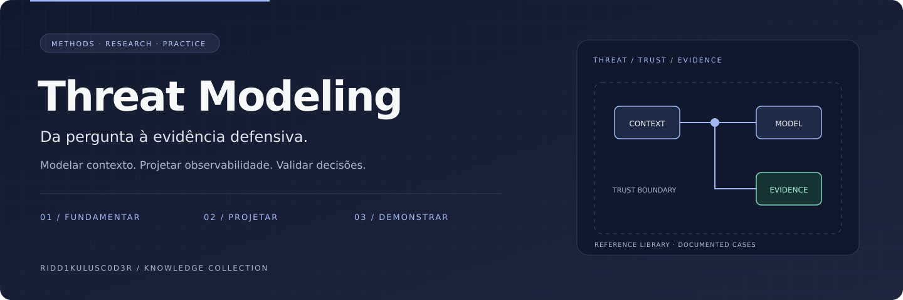

# Threat Modeling

**Manuais para desenhar perguntas melhores.**

Organizar links de manuais, métodos, livros e ferramentas de modelagem de ameaças por objetivo e nível de profundidade.

[Comece aqui](docs/COMECE-AQUI.md) · [Referências comentadas](docs/REFERENCIAS.md) · [Bibliografia](docs/BIBLIOGRAFIA.md) · [Trilha de leitura](docs/TRILHA-DE-LEITURA.md) · [Identidade visual](docs/IDENTIDADE-VISUAL.md)

## Objetivo e fronteiras

É uma biblioteca de referências. TCEM — Threat Context Engineering Method — é a metodologia autoral mantida em Cyber-Threat-Context-Modeling. Este catálogo não substitui nem redefine o TCEM.

## Caminhos de uso

| Etapa | Pergunta de trabalho | Entrega |
|---|---|---|
| Aprender | Entender processo e perguntas | Manual introdutório |
| Selecionar | Comparar abordagem e contexto | Referência metodológica |
| Aplicar | Encontrar exemplos e ferramentas | Guia de aplicação |

## Começar

1. Leia o [guia de entrada](docs/COMECE-AQUI.md).
2. Escolha uma [referência pelo problema](docs/REFERENCIAS.md), não pela popularidade.
3. Registre objetivo, fonte, data e limitações do recurso selecionado.

## Estado atual

Catálogo documental de links, bibliografia comentada e trilha de leitura, com orientação editorial. Não há execução de ferramentas ou monitoramento ao vivo.

## Contribuir

Inclua problema resolvido, fonte original, data, limitações e condições de reutilização. Diferencie observação, interpretação e hipótese. Recursos externos permanecem sujeitos às licenças e condições dos respectivos autores.

## Conexões no portfólio

[Cyber-Threat-Context-Modeling](https://github.com/Ridd1kulusC0d3r/Cyber-Threat-Context-Modeling) · [CyberFrameworks](https://github.com/Ridd1kulusC0d3r/CyberFrameworks) · [AppSec](https://github.com/Ridd1kulusC0d3r/AppSec)

As fronteiras acima definem a direção deste projeto; links relacionados não significam integrações implementadas.

## Biblioteca organizada

[Manuais e ferramentas por finalidade](docs/CATALOGO.md) · [Bibliografia comentada — 131 obras, ABNT + BibTeX](docs/BIBLIOGRAFIA.md) · [Trilha de leitura de 15 semanas](docs/TRILHA-DE-LEITURA.md) · [Acervo histórico preservado](docs/ACERVO-ANTERIOR.md)

Para citar em trabalhos acadêmicos, use [`referencias/referencias.bib`](referencias/referencias.bib). O campo `keywords` de cada entrada traz o eixo e o status de verificação.
