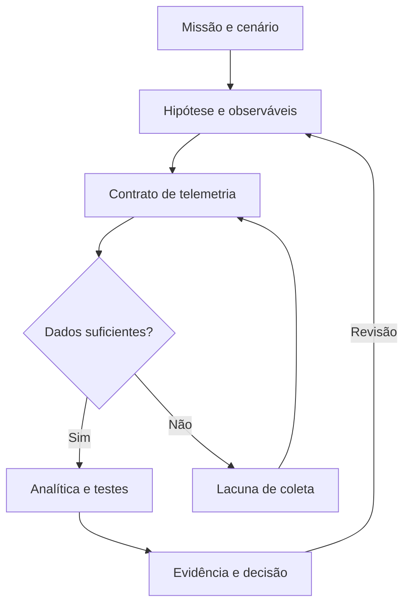

  

# Threat Modeling

**Manuais para desenhar perguntas melhores — e transformar modelos em evidência defensiva.**

Biblioteca comentada de modelagem de ameaças, inteligência e engenharia de detecção. Livros, papers, métodos e conferências organizados pelo que ajudam você a produzir.

  <a href="docs/COMECE-AQUI.md"><strong>Comece aqui</strong></a> &nbsp;·&nbsp;
  <a href="docs/BIBLIOGRAFIA.md">Bibliografia</a> &nbsp;·&nbsp;
  <a href="docs/ENGENHARIA-DE-DETECCAO.md">Engenharia de detecção</a> &nbsp;·&nbsp;
  <a href="cases/README.md">Cases</a>

> **Estado do acervo:** documentação e curadoria. Os seis cases são propostas de laboratório, ainda não executadas. O catálogo não declara cobertura operacional.

---

## Escolha sua pergunta

| **01 · FUNDAMENTAR** | **02 · PROJETAR** | **03 · DEMONSTRAR** |
|---|---|---|
| Que referências sustentam minha análise? | O que precisamos observar para detectar? | Que teste sustenta nossa conclusão? |
| [43 referências comentadas](docs/BIBLIOGRAFIA.md) | [25 recursos de engenharia](docs/ENGENHARIA-DE-DETECCAO.md) | [6 roteiros de case](cases/README.md) |
| Manifestos, livros, papers e métodos | Sensores, datasets, correlação e validação | Hipóteses, benignos, variantes e degradação |

## Uma biblioteca orientada a entregas

| Quero… | Começar por… | Produzir… |
|---|---|---|
| Aprender modelagem | [Rota guiada](docs/COMECE-AQUI.md) | Escopo, perguntas e pressupostos |
| Selecionar uma abordagem | [Catálogo de métodos](docs/CATALOGO.md) | Justificativa de escolha |
| Construir um referencial | [Bibliografia comentada](docs/BIBLIOGRAFIA.md) | Fundamentação com limites explícitos |
| Estudar DEF CON e conferências | [Acervo de apresentações](docs/CONFERENCIAS.md) | Ficha crítica e exercício derivado |
| Modelar para detecção | [Guia de engenharia](docs/ENGENHARIA-DE-DETECCAO.md) | Contrato de telemetria e hipótese |
| Documentar um experimento | [Template de case](templates/CASE-DETECCAO.md) | Entrada, esperado, observado e decisão |

## Do contexto ao teste

## Cases para desenvolver

| Roteiro | Pergunta central |
|---|---|
| [DCSync](cases/01-dcsync.md) | Replicação legítima ou abuso de identidade? |
| [OAuth](cases/02-oauth.md) | Permissão concedida, utilizada ou comprometimento confirmado? |
| [CloudTrail](cases/03-cloudtrail.md) | Evasão, manutenção ou perda de entrega? |
| [Movimento lateral](cases/04-movimento-lateral.md) | Como distinguir sequência suspeita de administração? |
| [CI/CD](cases/05-cicd.md) | Código não confiável atravessou uma fronteira privilegiada? |
| [Degradação](cases/06-degradacao.md) | A regra continua habilitada, mas perdeu capacidade? |

**Primeira sequência sugerida:** DCSync → CloudTrail → degradação. Comece com fontes e dados identificados; avance de fixture para replay e laboratório.

## Critério editorial

- Fonte original, autoria, tipo de publicação, contribuição e limitação.
- Fato, inferência e hipótese identificados separadamente.
- Preprint, artigo publicado e apresentação não recebem o mesmo peso.
- Visibilidade não equivale a detecção; mapeamento não comprova eficácia.
- Links para obras completas em suas fontes; sem cópia de livros ou PDFs de terceiros.
- Consulta documental não significa teste de ferramentas nem leitura integral de todas as obras.

[Referências e política de uso](docs/REFERENCIAS.md) · [Acervo histórico](docs/ACERVO-ANTERIOR.md) · [Identidade visual](docs/IDENTIDADE-VISUAL.md)

## Relação com o portfólio

Esta biblioteca organiza referências e exercícios. O **[TCEM — Threat Context Engineering Method](https://github.com/Ridd1kulusC0d3r/Cyber-Threat-Context-Modeling)** mantém sua metodologia autoral, especificação e implementação no projeto de origem. Este repositório não substitui nem redefine o TCEM.

[CyberFrameworks](https://github.com/Ridd1kulusC0d3r/CyberFrameworks) · [AppSec](https://github.com/Ridd1kulusC0d3r/AppSec)

## Contribuir

Inclua problema resolvido, fonte, autoria, versão/data, limitações e condições de reutilização. Para cases, use o [template](templates/CASE-DETECCAO.md) e registre evidências antes de alterar o estado para validado.
