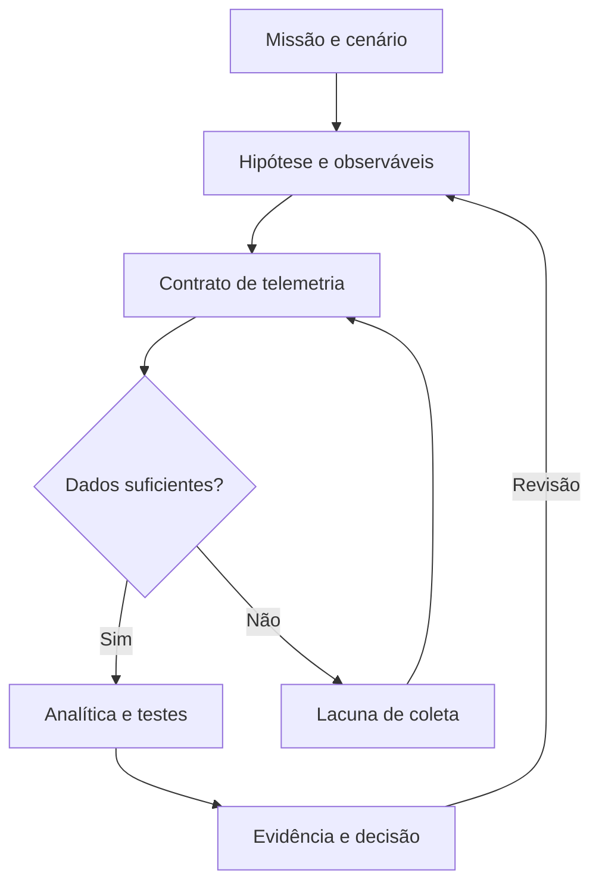

<p align="center">
  
</p>

<p align="center">
  <a href="https://github.com/Ridd1kulusC0d3r/Threat-Modeling/actions/workflows/validate.yml"></a>
  
  
</p>

**Uma biblioteca awesome de modelagem de ameaças, com a evidência anexada.** Livros, papers, métodos, ferramentas e conferências escolhidos pelo que ajudam você a produzir: um modelo, uma hipótese, uma detecção. Cada recurso traz o **grau da fonte**, o acesso, o nível e o **limite** conhecido. O que foi lido fica separado do que foi apenas listado.

<!-- lang-bar -->
**Português** · [English](README.en.md)
<!-- /lang-bar -->

**[Acervo completo](docs/AWESOME.md)** · [Por tema](docs/TEMAS.md) · [Métodos](docs/METODOS.md) · [Metodologia](docs/METODOLOGIA.md) · [Cases](cases/README.md) · [Contribuir](CONTRIBUTING.md)

> **Estado do acervo:** curadoria e documentação. Os seis cases são propostas de laboratório, ainda não executadas. O catálogo não declara cobertura operacional, e listar uma ferramenta não é avaliá-la.

## Em um minuto

<!-- gen:stats:start -->

| Recursos | Métodos | Tipos | Temas | Links verificados |
|:---:|:---:|:---:|:---:|:---:|
| **106** | **19** | **10** | **11** | **80** |

| Grau | Recursos | Significado |
|:---:|:---:|---|
| **A** | 32 | Fonte primária ou institucional: padrão, órgão público, publicação com revisão por pares ou mantenedor do método. |
| **B** | 52 | Fonte primária sem revisão formal: livro, preprint, guia de comunidade, página do autor ou repositório do mantenedor. |
| **C** | 17 | Material de fornecedor, proponente comercial ou ferramenta de terceiros. |
| **D** | 1 | Comentário ou fonte secundária. |
| **E** | 4 | Legado: herdado do acervo anterior e ainda não revalidado. |

<!-- gen:stats:end -->

Grau mede o **tipo de fonte**, não a qualidade das ideias: um guia de comunidade (B) pode ser mais útil que um paper (A). A [metodologia](docs/METODOLOGIA.md) explica os graus, os níveis e como um link é verificado.

## Comece por

<!-- gen:featured:start -->

| Comece por | Tipo | Grau | Por quê |
|---|---|:---:|---|
| [Threat Modeling Manifesto](https://www.threatmodelingmanifesto.org/) | Manifestos e princípios | **B** | Valores, princípios e antipadrões. |
| [A Tradecraft Primer: Structured Analytic Techniques for Improving Intelligence Analysis](https://www.cia.gov/resources/csi/static/Tradecraft-Primer-apr09.pdf) | Guias e frameworks | **A** | Técnicas estruturadas de análise para desafiar julgamentos, expor modelos mentais e lidar com incerteza; inclui verificação de premissas e análise de hipóteses concorrentes. |
| [DeTT&CT — Data quality](https://github.com/rabobank-cdc/DeTTECT/wiki/data-quality-scoring) | Guias e frameworks | **B** | Completude, atraso, consistência e retenção. |
| [OWASP Threat Modeling Cheat Sheet](https://cheatsheetseries.owasp.org/cheatsheets/Threat_Modeling_Cheat_Sheet.html) | Guias e frameworks | **B** | Entender o processo e suas perguntas fundamentais; fonte consultada nesta edição |
| [Sensor Mappings to ATT&CK](https://center-for-threat-informed-defense.github.io/sensor-mappings-to-attack/) | Guias e frameworks | **A** | Sensores, eventos e visibilidade. |
| [Attack Flow](https://center-for-threat-informed-defense.github.io/attack-flow/) | Métodos e modelos | **A** | Sequência de comportamentos. |
| [MITRE ATLAS](https://atlas.mitre.org/) | Métodos e modelos | **A** | Base de conhecimento de táticas e técnicas adversárias contra sistemas de IA, no estilo ATT&CK. |
| [MITRE ATT&CK](https://attack.mitre.org/) | Métodos e modelos | **A** | Vocabulário de comportamentos adversários observados; base para mapear hipóteses e cobertura. |
| [Summiting the Pyramid](https://center-for-threat-informed-defense.github.io/summiting-the-pyramid/) | Métodos e modelos | **A** | Robustez, decomposição e cobertura. |
| [Threat Modeling with ATT&CK](https://center-for-threat-informed-defense.github.io/threat-modeling-with-attack/) | Métodos e modelos | **A** | Comportamento adversário na modelagem. |
| [Intelligence-Driven Incident Response](https://www.oreilly.com/library/view/intelligence-driven-incident-response/9781098120672/) | Livros | **B** | Inteligência e operação. |
| [Psychology of Intelligence Analysis](https://www.cia.gov/resources/csi/books-monographs/psychology-of-intelligence-analysis-2/) | Livros | **A** | Vieses, hipóteses e incerteza. |
| [Threat Modeling: Designing for Security](https://threatmodelingbook.com/books) | Livros | **B** | Fundamentos e abordagens. |
| [A review of threat modelling approaches for APT-style attacks](https://doi.org/10.1016/j.heliyon.2021.e05969) | Papers e trabalhos técnicos | **A** | Revisão de abordagens de modelagem de ameaças para ataques do tipo APT (Heliyon). |
| [HOLMES: Real-Time APT Detection through Correlation of Suspicious Information Flows](https://www.seclab.cs.sunysb.edu/seclab/pubs/holmes19.pdf) | Papers e trabalhos técnicos | **A** | Fluxos e correlação contextual. |
| [The Diamond Model of Intrusion Analysis](https://www.activeresponse.org/wp-content/uploads/2013/07/diamond.pdf) | Papers e trabalhos técnicos | **B** | Adversário, capacidade, infraestrutura e vítima. |
| [Threat modeling — A systematic literature review](https://doi.org/10.1016/j.cose.2019.03.010) | Papers e trabalhos técnicos | **A** | Mapear métodos e trabalhos relacionados. |
| [Keynote \| Threat Modeling Agentic AI Systems: Proactive Strategies for Security and Resilience](https://www.youtube.com/watch?v=R49Cv7pJ2KA) | Conferências e talks | **B** | Keynote gravada sobre modelagem de ameaças para sistemas de IA agêntica. |
| [ThreatModCon](https://www.threatmodcon.com/) | Conferências e talks | **B** | Conferência dedicada exclusivamente a threat modeling; fonte de talks para extrair ideias e exercícios. |
| [Threat Hunter Playbook](https://github.com/OTRF/ThreatHunter-Playbook) | Ferramentas e repositórios | **B** | Notebooks de hipótese, consultas e evidências. |

<!-- gen:featured:end -->

## Escolha sua pergunta

| **01 · FUNDAMENTAR** | **02 · PROJETAR** | **03 · DEMONSTRAR** |
|---|---|---|
| Que referências sustentam minha análise? | O que precisamos observar para detectar? | Que teste sustenta nossa conclusão? |
| [Bibliografia comentada](docs/BIBLIOGRAFIA.md) · [métodos](docs/METODOS.md) | [Engenharia de detecção](docs/ENGENHARIA-DE-DETECCAO.md) | [Roteiros de case](cases/README.md) |
| Manifestos, livros, papers e métodos | Sensores, datasets, correlação e validação | Hipóteses, benignos, variantes e degradação |

## O que há aqui

| Camada | O que contém | Comece por |
|---|---|---|
| **Acervo** | Recursos com grau de fonte, acesso, nível e limite, em dados estruturados | [`data/resources.json`](data/resources.json) · [Acervo completo](docs/AWESOME.md) |
| **Métodos** | Cada método com a pergunta que responde, o que produz, quando usar e o limite | [Métodos](docs/METODOS.md) · [`data/methods.json`](data/methods.json) |
| **Temas** | Lista no formato awesome por tema: CTI, detecção, APT, IA agêntica, psicologia da análise | [Por tema](docs/TEMAS.md) |
| **Guias** | Rota guiada, bibliografia comentada, engenharia de detecção e conferências | [Comece aqui](docs/COMECE-AQUI.md) |
| **Cases** | Roteiros de laboratório com hipótese, benignos, variantes e degradação | [Cases](cases/README.md) · [Template](templates/CASE-DETECCAO.md) |
| **Ferramentas** | Busca, validação e geração em Python, só biblioteca padrão | [Guia rápido](#guia-rápido) |

## Por tema

<!-- gen:topics:start -->

| Tema | Recursos |
|---|:---:|
| [Modelagem de ameaças](docs/TEMAS.md#modelagem-de-ameaças) | 59 |
| [Engenharia de detecção](docs/TEMAS.md#engenharia-de-detecção) | 30 |
| [Inteligência de ameaças (CTI)](docs/TEMAS.md#inteligência-de-ameaças-cti) | 30 |
| [APT e campanhas persistentes](docs/TEMAS.md#apt-e-campanhas-persistentes) | 5 |
| [IA e sistemas agênticos](docs/TEMAS.md#ia-e-sistemas-agênticos) | 7 |
| [ICS e sistemas ciberfísicos](docs/TEMAS.md#ics-e-sistemas-ciberfísicos) | 3 |
| [Privacidade](docs/TEMAS.md#privacidade) | 3 |
| [Psicologia, vieses e análise](docs/TEMAS.md#psicologia-vieses-e-análise) | 2 |
| [Emulação adversária](docs/TEMAS.md#emulação-adversária) | 8 |
| [Proveniência e grafos](docs/TEMAS.md#proveniência-e-grafos) | 4 |
| [Nuvem](docs/TEMAS.md#nuvem) | 2 |

<!-- gen:topics:end -->

## Guia rápido

```bash
make check                                       # valida os dados, roda os testes e confere os arquivos gerados
python scripts/query.py search "apt provenance"  # busca por palavras inteiras
python scripts/query.py list --topic psychology --max-grade B
python scripts/query.py list --type tool --access free --level intro
python scripts/query.py show holmes              # registro completo
python scripts/query.py method stride            # método com fontes e limite
python scripts/query.py export --format csv > acervo.csv
python scripts/check_links.py                    # relatório de links (precisa de rede)
```

Python 3.10 ou superior, apenas biblioteca padrão. `make build` regenera [`docs/AWESOME.md`](docs/AWESOME.md), [`docs/TEMAS.md`](docs/TEMAS.md), [`docs/METODOS.md`](docs/METODOS.md) e os blocos gerados deste README a partir de `data/`. Edite os dados, nunca os arquivos gerados.

## Como o material entra

```text
nota de estudo ─► triagem ─► grau + limite ─► data/*.json ─► validação ─► build ─► docs e README
 Notion / issue    humana     obrigatórios     fonte única       CI        gerado
```

Nada entra sem **fonte original, autoria, tipo, contribuição e limitação**. As notas de estudo do Notion foram importadas com esse filtro: o que virou recurso e o que ficou de fora está em [Fontes e proveniência](docs/FONTES-E-PROVENIENCIA.md).

## Do contexto ao teste



## Cases para desenvolver

| Roteiro | Pergunta central |
|---|---|
| [DCSync](cases/01-dcsync.md) | Replicação legítima ou abuso de identidade? |
| [OAuth](cases/02-oauth.md) | Permissão concedida, utilizada ou comprometimento confirmado? |
| [CloudTrail](cases/03-cloudtrail.md) | Evasão, manutenção ou perda de entrega? |
| [Movimento lateral](cases/04-movimento-lateral.md) | Como distinguir sequência suspeita de administração? |
| [CI/CD](cases/05-cicd.md) | Código não confiável atravessou uma fronteira privilegiada? |
| [Degradação](cases/06-degradacao.md) | A regra continua habilitada, mas perdeu capacidade? |

**Primeira sequência sugerida:** DCSync → CloudTrail → degradação. Comece com fontes e dados identificados; avance de fixture para replay e laboratório.

## Critério editorial

- Fonte original, autoria, tipo de publicação, contribuição e limitação.
- Fato, inferência e hipótese identificados separadamente.
- Preprint, artigo publicado e apresentação não recebem o mesmo peso.
- Visibilidade não equivale a detecção; mapeamento não comprova eficácia.
- Links para obras completas em suas fontes; sem cópia de livros ou PDFs de terceiros.
- Consulta documental não significa teste de ferramentas nem leitura integral de todas as obras.
- Um link só recebe a data de verificação quando respondeu; bloqueio a robôs e falha de rede não contam como verificação.

[Referências e política de uso](docs/REFERENCIAS.md) · [Acervo histórico](docs/ACERVO-ANTERIOR.md) · [Identidade visual](docs/IDENTIDADE-VISUAL.md)

## Relação com o portfólio

Esta biblioteca organiza referências e exercícios. O **[TCEM — Threat Context Engineering Method](https://github.com/Ridd1kulusC0d3r/Cyber-Threat-Context-Modeling)** mantém sua metodologia autoral, especificação e implementação no projeto de origem. Este repositório não substitui nem redefine o TCEM.

O **[LLMInjection](https://github.com/Ridd1kulusC0d3r/LLmInjection)** cobre o panorama de ameaças a sistemas LLM e agênticos com a mesma disciplina de graus A–E; a camada de IA deste acervo ([MITRE ATLAS](docs/METODOS.md#mitre-atlas), [MAESTRO](docs/METODOS.md#maestro), [PLOT4ai](docs/METODOS.md#plot4ai)) aponta para ele.

[CyberFrameworks](https://github.com/Ridd1kulusC0d3r/CyberFrameworks) · [AppSec](https://github.com/Ridd1kulusC0d3r/AppSec)

## Contribuir

Sugira um recurso pelo [formulário de issue](https://github.com/Ridd1kulusC0d3r/Threat-Modeling/issues/new/choose) ou abra um PR editando `data/resources.json`. O [guia de contribuição](CONTRIBUTING.md) lista os campos obrigatórios e o que o validador rejeita.
